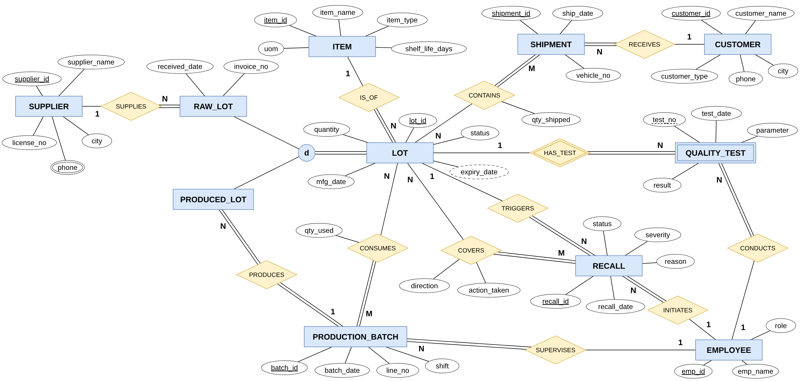
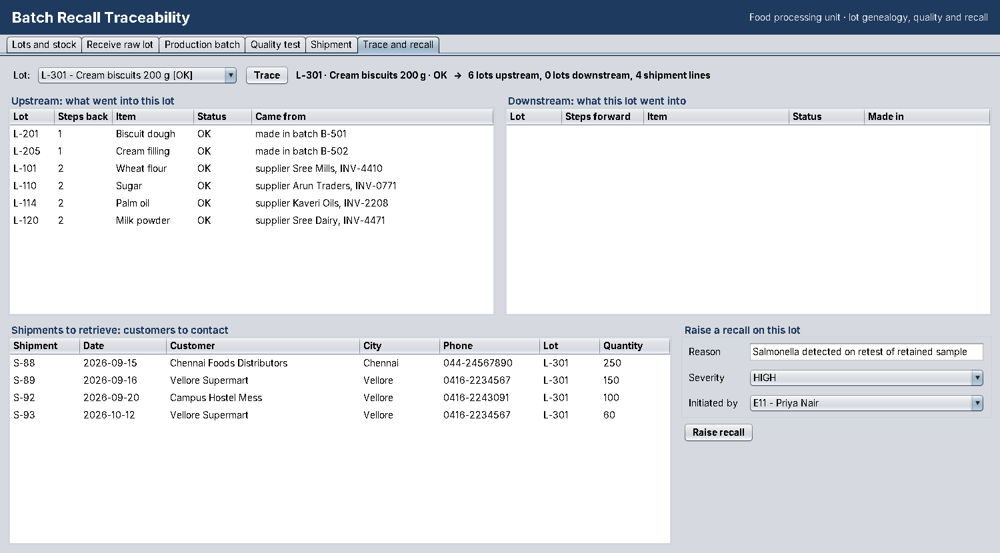
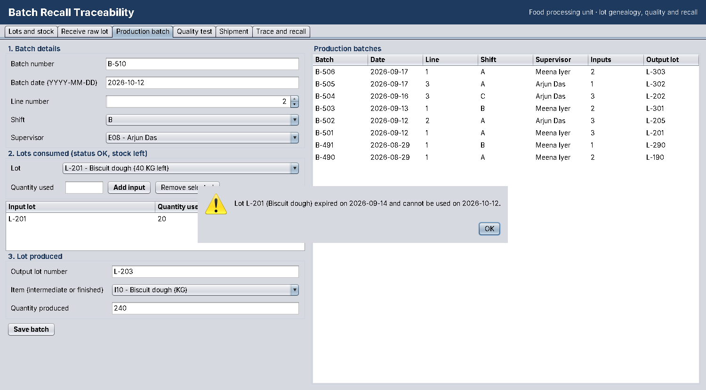

# Batch Recall Traceability

A database application for a food processing unit. Given one defective lot, it finds **every downstream shipment** (what the lot went into and which customers received it) and **every upstream input** (what went into the lot and which suppliers it came from), then raises a recall.

Built for **BACSE202 Database Systems** (VIT, SCOPE) as a three-phase course project:
Oracle database · Java Swing front end · JDBC connectivity.



## Why a database

A recall is a graph problem. A raw lot is consumed by a production batch, which produces a new lot, which is consumed by another batch, and so on until finished goods are shipped. Doing this by hand across paper registers is slow and error-prone. In this schema every "made from" link is a row in `BATCH_INPUT` joined to `PRODUCED_LOT`, so one recursive SQL query walks the chain in either direction to any depth.

```sql
WITH down (lot_id, lvl) AS (
  SELECT lot_id, 0 FROM lot WHERE lot_id = 'L-205'
  UNION ALL
  SELECT pl.lot_id, d.lvl + 1
  FROM down d
  JOIN batch_input bi  ON bi.lot_id = d.lot_id
  JOIN produced_lot pl ON pl.batch_id = bi.batch_id
)
SELECT * FROM down;
```

## Features

| Screen | User | What it does |
|---|---|---|
| Lots and stock | everyone | every lot with status, stock left and expiry date |
| Receive raw lot | stores keeper | registers a lot bought from a supplier |
| Production batch | production supervisor | records the lots consumed and the lot produced |
| Quality test | QA officer | records a test; a FAIL puts the lot on HOLD |
| Shipment | dispatch clerk | records finished lots sent to a customer |
| Trace and recall | QA officer | upstream and downstream trace, customers to contact, one-click recall |



### Business rules

1. Only raw items can be received; quantities must be positive; dates cannot be in the future; lot numbers are unique.
2. A batch input must be OK (not on HOLD or RECALLED), not expired on the batch date, not a finished product, and within its stock left.
3. A failed quality test puts the lot on HOLD.
4. Only finished, OK, unexpired lots can be shipped, never more than the stock left.
5. A recall marks the defective lot and everything made from it RECALLED, puts its inputs on HOLD for investigation, and records every affected lot. One open recall per lot.

Every save runs in a single transaction (auto-commit off), and all SQL uses `PreparedStatement` parameters.



## Database design

15 tables in 3NF, mapped from the EER diagram above:

| Group | Tables |
|---|---|
| Master data | `SUPPLIER`, `SUPPLIER_PHONE`, `ITEM`, `EMPLOYEE`, `CUSTOMER` |
| Lots (specialization) | `LOT`, `RAW_LOT`, `PRODUCED_LOT` |
| Production | `PRODUCTION_BATCH`, `BATCH_INPUT`, `QUALITY_TEST` |
| Distribution | `SHIPMENT`, `SHIPMENT_LINE` |
| Recall | `RECALL`, `RECALL_LOT` |

Plus views `LOT_STOCK` (quantity left) and `LOT_EXPIRY` (derived expiry date), and sequence `RECALL_SEQ`.
The schema has 15 primary keys, 18 foreign keys, 18 CHECK constraints and 1 UNIQUE constraint.
The editable diagram is [`docs/er-diagram.drawio`](docs/er-diagram.drawio) (open it at [app.diagrams.net](https://app.diagrams.net)).

## Project structure

```
sql/
  00_create_user.sql    create the application user (run once as SYSTEM)
  00_drop.sql           drop all objects (safe on an empty schema)
  01_schema.sql         DDL: tables, constraints, views, sequence
  02_sample_data.sql    DML: 106 sample rows, three-level lot genealogy
  03_queries.sql        stock report, upstream/downstream traces, recall summary
src/trace/
  App.java              entry point
  Db.java               JDBC connection from db.properties
  TraceDao.java         every SQL statement
  TraceService.java     business rules and transactions
  Model.java            small value classes
  ui/                   Swing screens
tests/trace/ui/
  RuleTests.java        23 business-rule tests (run on H2 in Oracle mode)
docs/                   ER diagram and screenshots
db.properties           connection settings
run.bat / run.sh        compile and run
lib/                    put the Oracle JDBC driver here
```

## Getting started

**Requirements:** Oracle Database (XE 11g or later), JDK 8 or later, and the Oracle JDBC driver.

1. **Create the database objects** in SQL*Plus:
   ```
   sqlplus system/<password>
   SQL> @sql/00_create_user.sql
   SQL> connect trace_app/trace_app
   SQL> @sql/01_schema.sql
   SQL> @sql/02_sample_data.sql
   ```
   On Oracle 12c and later, connect to the pluggable database (for example `@localhost:1521/XEPDB1`).

2. **Add the JDBC driver:** copy `ojdbc8.jar` (JDK 8) or `ojdbc11.jar` (JDK 11+) into `lib/`. It ships with Oracle in `<ORACLE_HOME>/jdbc/lib/`, or can be downloaded from oracle.com. It is not included in this repository because of its licence.

3. **Check `db.properties`:**
   ```
   db.url=jdbc:oracle:thin:@localhost:1521:XE
   db.user=trace_app
   db.password=trace_app
   ```
   For a pluggable database use `jdbc:oracle:thin:@localhost:1521/XEPDB1`.

4. **Run:** double-click `run.bat` on Windows, or `sh run.sh` on Linux and macOS.

## Running the tests

The rule tests use the [H2 database](https://www.h2database.com) in Oracle-compatibility mode, so no Oracle server is needed.
Download `h2-2.2.224.jar` into `lib/`, then (JDK 11+):

```
javac -d out $(find src -name "*.java")
javac -cp out -d out-test tests/trace/ui/RuleTests.java
java -cp "out:out-test:lib/h2-2.2.224.jar" trace.ui.RuleTests sql
```

Expected output ends with `23 passed, 0 failed`.

## Sample data

A small biscuit plant: 4 suppliers, 8 items, 15 lots, 8 batches, 6 shipments to 4 customers and one closed recall.
All names, invoice numbers and quantities are illustrative.

## Project phases

| Phase | Content |
|---|---|
| 1. Design foundation | problem and requirements, EER diagram, relational mapping, normalization to 3NF |
| 2. Implementation core | DDL, DML, Swing front end, business logic, JDBC connectivity |
| 3. Integration and delivery | full CRUD, testing and validation, report and demonstration |

## Team

- [Member 1 name] · [Reg. No.]
- [Member 2 name] · [Reg. No.]
- [Member 3 name] · [Reg. No.]

Faculty: [Faculty name] · BACSE202 Database Systems · SCOPE, Vellore Institute of Technology
